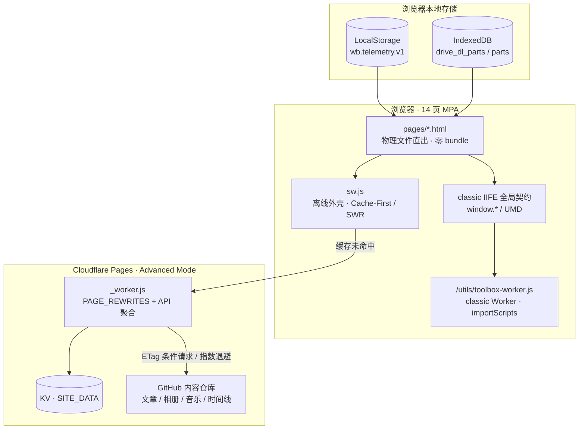
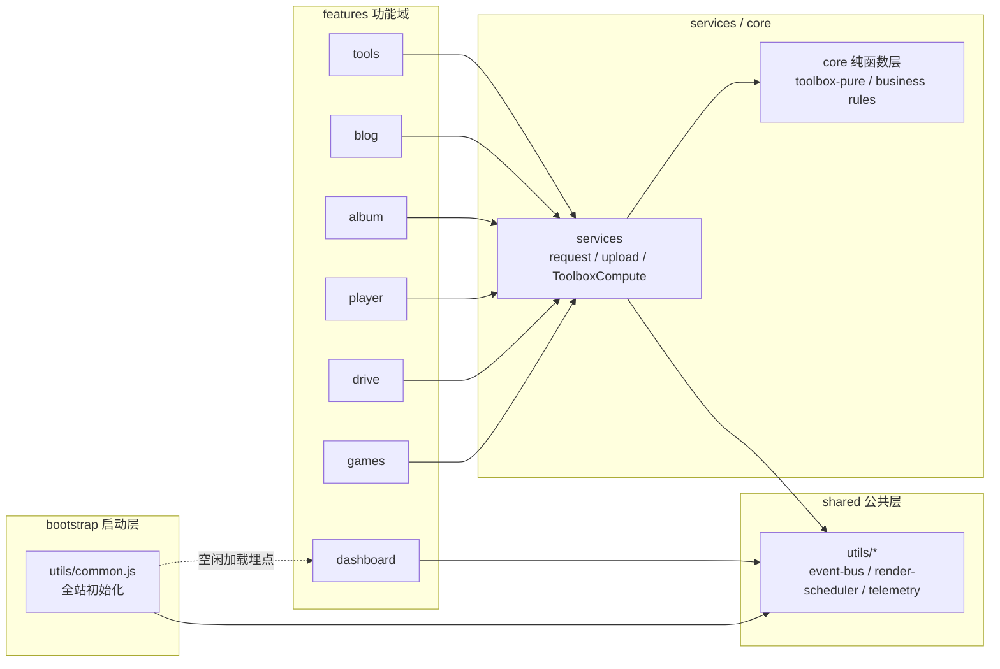
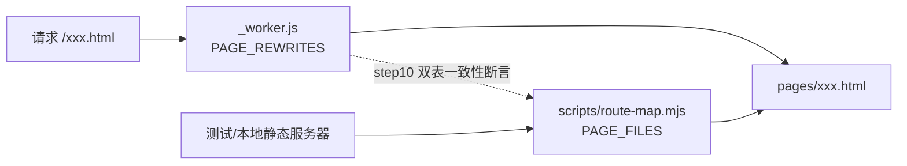
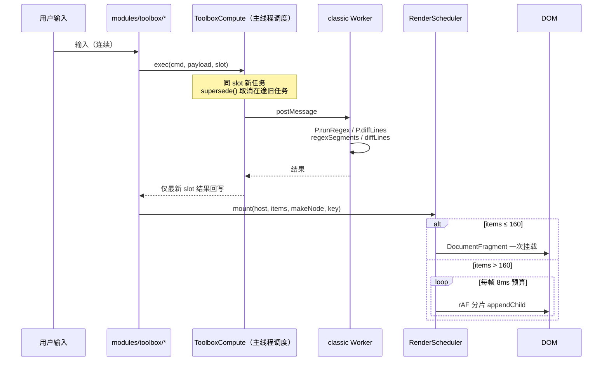
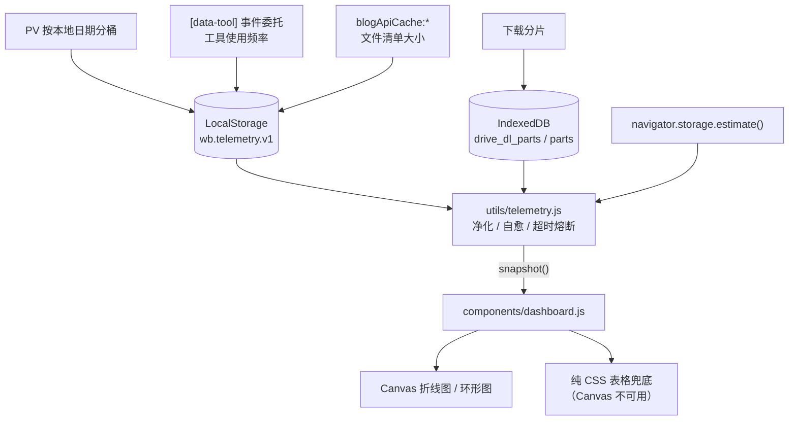
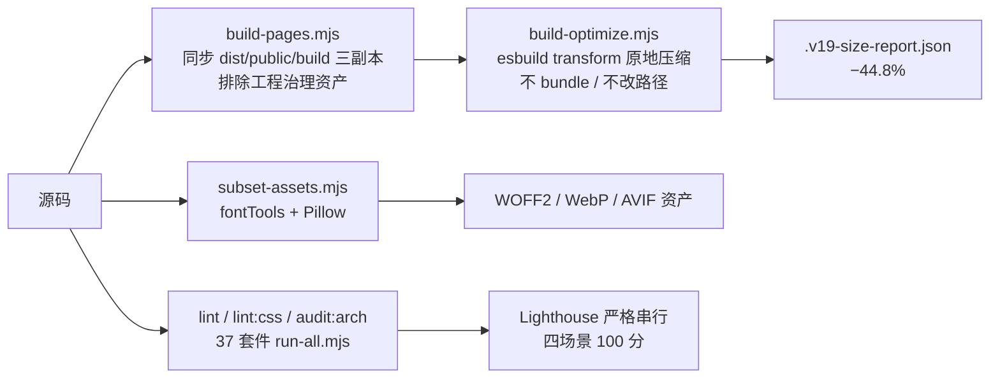

# 系统架构说明（v22.0）

> **唯一事实来源**：逻辑域以 `src/architecture.mjs` 为准，物理路由以 `scripts/route-map.mjs` 与 `_worker.js` 的**双表**为准，二者由 `tests/step10-routes-verify.mjs` 强制校验一致。
> 本文件由 v22.0 通宵工程补齐，含最新 Mermaid 架构图。架构红线见文末。

---

## 1. 整体分层

**要点**：站点是纯静态 MPA，页面与资源均为磁盘上的物理文件；`_worker.js` 只做 URL 重写与后端 API 聚合，不参与 HTML 构建；Service Worker 承担离线与缓存策略，二者职责不重叠。

---

## 2. 逻辑架构（Feature-Based，11 个 UNITS / 7 个 FEATURES）

分层规则由 `scripts/arch-audit.mjs` 强制：**依赖方向单向（features → services → core → shared）**、零双向循环依赖、前端脚本 100% 有域归属、零 `console.log/debug/info`、零裸 `fetch`。当前审计 **7/7 通过**（43 个前端脚本 / 31 个全局导出）。

---

## 3. 路由双表与 14 页

| 分类 | 页面 |
|---|---|
| 内容 | `index` `blog` `post` `album` `links` `timeline` `guestbook` |
| 应用 | `games` `player` `drive` `mc` `tools` |
| 后台 | `admin` `dashboard`（`noindex, nofollow`） |

---

## 4. 工具箱：异步计算链与 DOM 渲染拦截

- Worker 复用：`importScripts("/utils/toolbox-constants.js", "/utils/toolbox-pure.js")`，三端（页面 / Worker / Node VM）同一份纯函数内核。
- 超时熔断 `C.WORKER_TIMEOUT_MS`，Worker 不可用时降级主线程 `fallback`。
- 调度器缺失或 Worker 缺失时，`diff.js` / `regex.js` 回退等价 `DocumentFragment` 一次性挂载（混沌测试 S5 覆盖）。

---

## 5. Dashboard 数据流（纯本地、零网络）

埋点层完全自包含（不读取 `common.js` 的全局），零网络请求、零第三方库、零 `console` 输出；脏 JSON 自愈、非数字计数过滤、路径白名单、工具 id 正则校验。

---

## 6. 构建与质量门禁

---

## 7. 红线契约（不可破坏）

| 红线 | 原因 |
|---|---|
| MPA 物理文件直出，**禁止 bundle / 禁止物理迁移 `src/pages`** | classic `window.*` 全局契约、CSP nonce、Worker `importScripts` 三端复用 |
| 路由双表同步 | `step10` 硬断言，不同步会 404 |
| `CACHE_VERSION` 与 `toolbox-constants.js VERSION` 同版本 | `step1` / `step27` 版本三方对齐断言 |
| `/og-image.png` 保持 200 + `image/png` | `step3-seo-csp` 硬断言；WebP/AVIF 只能作副本 |
| 所有页面 head 契约（Critical CSS / EventBus=1 / noscript 配对 / prefetch 数量） | `step29 A7` / `step30 A2` 遍历 14 页校验 |
| Lighthouse 与 Playwright 禁止并行 | 避免 CPU 争抢造成伪负优化 |
| 禁止 force push | 远程历史为共享分支 |

> 部署形态现状与收敛建议见《部署形态收敛方案.md》；最新交付数据见《网页线·通宵工程战报.md》。
